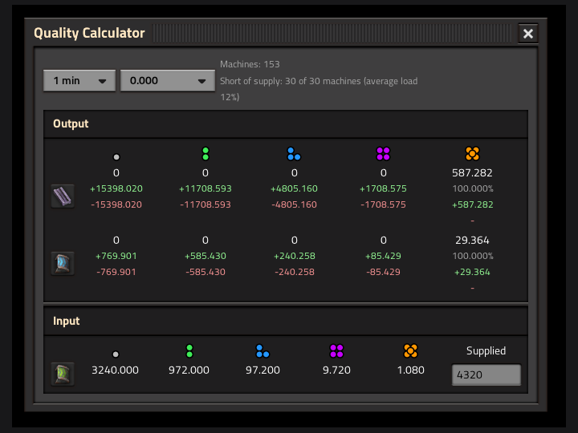
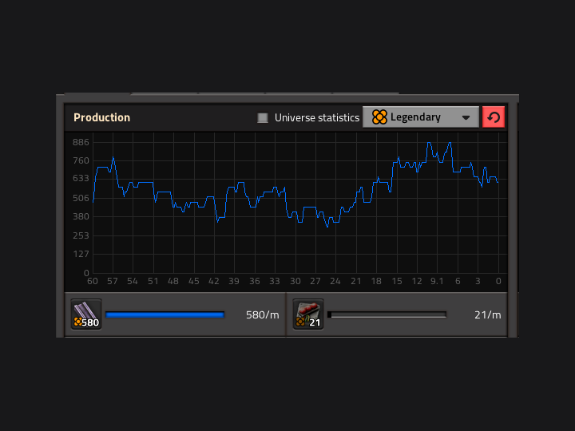
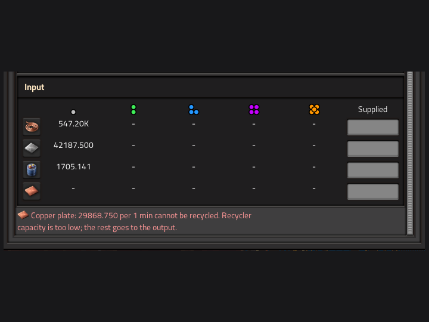

The mod is free. If you like it, you can say thanks with a one-time donation on Boosty: no subscription is needed.

**Support in English and Russian / Поддержка на русском и английском.** Questions, bugs and ideas: Discussion tab.

# Quality Calculator

**How good is your factory, really?** Drag a box over your machines and see how many items of each quality they make, and what you still have to feed in. Plan quality and recycler loops on paper before you build them, and tune them with the numbers in front of you.

Click the shortcut button (or press `Ctrl+Shift+Q`) and drag over the machines. Shift adds machines, Shift and right button removes them. No new items, nothing changes in your world.

*A real build: 153 machines, the output of every quality and the input it needs. The numbers come from the game, not from a guess.*

- **Counts what the game counts**: quality and productivity modules (and their quality), speed, built-in productivity and research, mining drills.
- **Loops with recyclers**: shows what comes out, what goes back into the loop and what has to come from outside.
- **Input by quality**: type how much of each item you really supply, and the window recalculates.

---

# Check it against the game

Pick a period and the rounding in the window: second, minute, 10 minutes or hour. The result is the theoretical maximum, with no downtime.

*The same build in the game's own production statistics: 580 legendary per minute there, 587 in the calculator. The calculator shows more: every quality, and what is made and what is spent.*

Hover over a number to learn more: who makes the item, who spends it, and the chance to get at least one during the chosen period.

# It tells you what is wrong

If something does not add up, the window says so in plain words: an item that cannot be recycled because the recyclers are too slow, machines that are short of supply, a raw material nobody delivers.

*A hint under the input table: the recyclers cannot keep up, the rest goes to the output.*

Use it to build better schemes: change the modules, add recyclers, change what you supply, select again and compare.

## Compatibility

Factorio 2.1 and 2.0 (separate downloads), requires the Quality mod. Works with other mods that add machines, modules or qualities. English and Russian.

## Support

Questions, bugs and ideas: Discussion tab.
